# AI Game Market

**My GitHub is a game you can walk in.** A 3D night market of games I made with AI agents: play them right there, read the 69 teardowns behind them, and see the projects around them.

### ▶ [Walk the market](https://condrusarsen.github.io/ai-game-lab/) · [Open as a list](https://condrusarsen.github.io/ai-game-lab/list/)

<a href="https://condrusarsen.github.io/ai-game-lab/">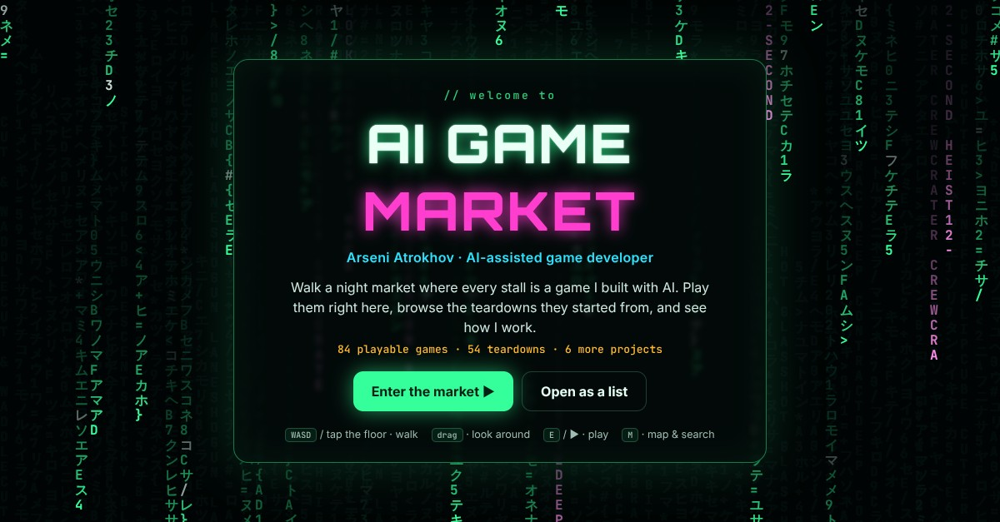</a>

I'm **Arseni Atrokhov**, an AI-assisted game developer and designer (Roblox/Luau, HTML5). I take a game from teardown to a playable, tested build: I make the design decisions and own the quality, AI coding agents write most of the code.

- **83 playable games**: 26 in the main rows, 57 more prototypes in the Vault.
- **69 teardowns** of reference games, 17 of them Roblox hits: core loop, rules, economy, first session. A public sample of the 600+ games I have analysed.
- **Workshop**: Roblox projects, a match-3 design case study, paid UI/UX client work (Figma), tools.

Most of these games were made from July to October 2026 in a small studio that builds games with AI agents: many I built solo, some together with a teammate.

Everything runs in the browser. Most games work on a phone.

## Games


### New releases

| | Game | What it is | |
|---|---|---|---|
| 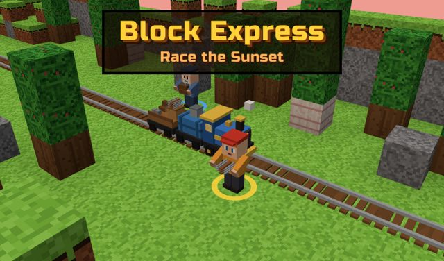 | **Block Express: Race the Sunset** | Blocky train builder: chop trees, break rocks, craft rails and lay the track before the engine catches up. Endless world, 8 locomotives, two-player mode. | [Play](https://condrusarsen.github.io/ai-game-lab/games/block-express/) |
| 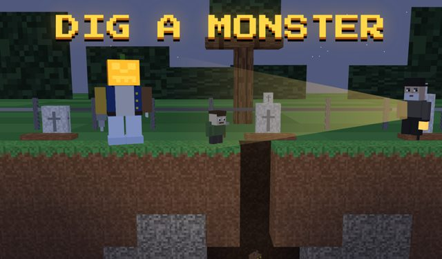 | **Dig a Monster** | Dig up a blocky graveyard at night, stitch a monster from 40 parts and defend the castle from pitchfork villagers. | [Play](https://condrusarsen.github.io/ai-game-lab/games/dig-a-monster/) |
| 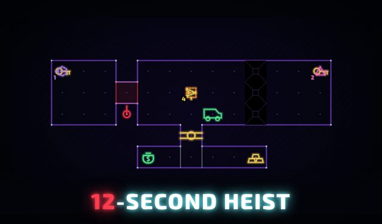 | **12-Second Heist** | Time-loop heist puzzle: every 12-second run becomes a copy of you that repeats its moves. 40 vaults, guards, lasers and keys. | [Play](https://condrusarsen.github.io/ai-game-lab/games/twelve-second-heist/) |
| 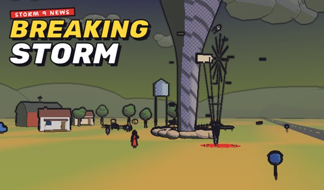 | **Breaking Storm Live** | You run the camera at a tiny TV station: keep the reporter, the twister and the flying cows in frame to win viewers. | [Play](https://condrusarsen.github.io/ai-game-lab/games/breaking-storm/) |
| 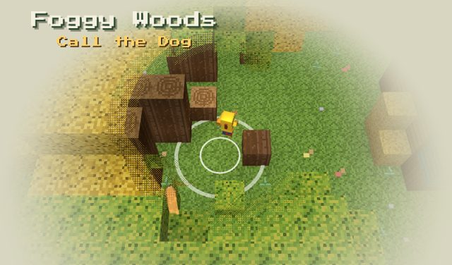 | **Foggy Woods: Call the Dog** | Mushroom hunting in the fog: call your dog, tell his bark from a mimicking wisp, cook dishes and fill orders. | [Play](https://condrusarsen.github.io/ai-game-lab/games/foggy-woods/) |
| 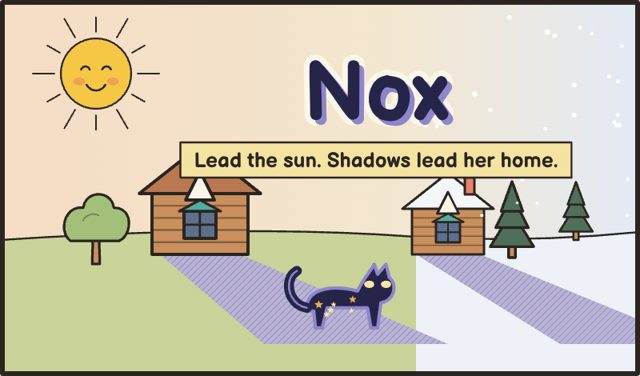 | **Nox** | Light-and-shadow puzzle: move the sun so the shadows of houses and trees build a path home for a scrap of night. 25 yards, 5 chapters. | [Play](https://condrusarsen.github.io/ai-game-lab/games/nox/) |
| 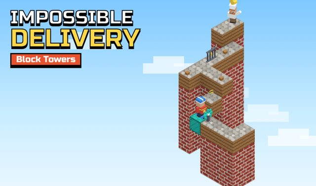 | **Impossible Delivery: Block Towers** | Optical-illusion puzzle: turn an impossible tower until the walkways line up. If it looks connected, it is connected. | [Play](https://condrusarsen.github.io/ai-game-lab/games/block-towers/) |
| 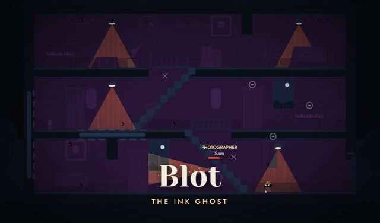 | **Blot: The Ink Ghost** | You are a living ink blot haunting a house: chain scares on the night inspectors and stay out of their flashlight beams. | [Play](https://condrusarsen.github.io/ai-game-lab/games/blot-ink-ghost/) |
| 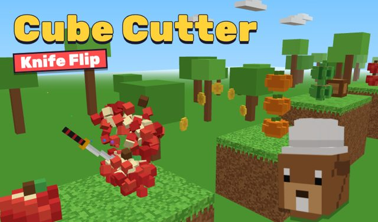 | **Cube Cutter: Knife Flip** | One-thumb knife toy: every tap flips the blade. Slice through everything and stop before the red studs. | [Play](https://condrusarsen.github.io/ai-game-lab/games/cube-cutter/) |

### Puzzle

| | Game | What it is | |
|---|---|---|---|
| 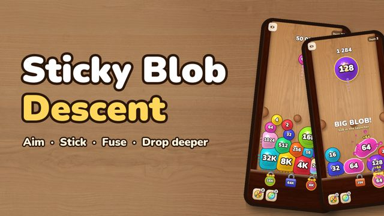 | **Sticky Blob Descent** | Aim sticky jelly blobs, fuse equal numbers, open the floor locks, and the whole board drops one chamber deeper. | [Play](https://condrusarsen.github.io/ai-game-lab/games/sticky-blob/) · [teardown](teardowns/sticky-blob-descent-reference.html) |
|  | **Late Again!** | Time-loop puzzle: play one family morning as each member in turn while your earlier takes repeat beside you. | [Play](https://condrusarsen.github.io/ai-game-lab/games/late/) |
| 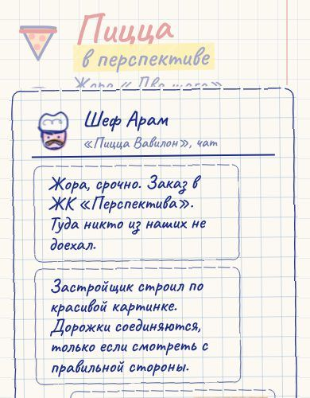 | **Pizza in Perspective** | Hand-drawn perspective puzzle: line two roofs up on screen, then walk across a bridge that exists only from your viewpoint. | [Play](https://condrusarsen.github.io/ai-game-lab/games/pizza-in-perspective/) |
|  | **Cut & Waddle** | Rope-cutting physics puzzle: get every penguin chick out of the frozen harbour. 60 classic rooms, 30 rescue rooms, a VS race. | [Play](https://condrusarsen.github.io/ai-game-lab/games/cut-and-waddle/) |

### Arcade & runners

| | Game | What it is | |
|---|---|---|---|
|  | **Sugar Siege** | 3D runner: grow a jelly worm, carry TNT to a candy castle gate, then fund and rebuild a city behind it. | [Play](https://condrusarsen.github.io/ai-game-lab/games/sugar-siege/) · [teardown](teardowns/sugar-siege-reference.html) |
| 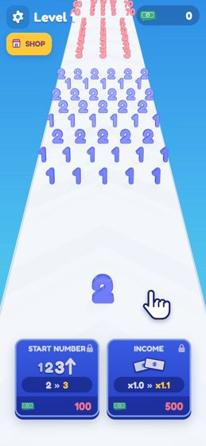 | **Digit Dash** | 3D number runner: swallow smaller numbers, avoid bigger ones, ram the wall staircase for cash. 40 authored layouts plus endless remixes. | [Play](https://condrusarsen.github.io/ai-game-lab/games/digit-dash/) · [teardown](teardowns/digit-dash-reference.html) |
| 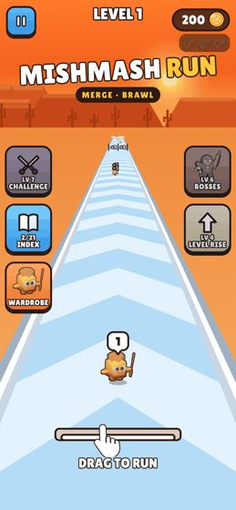 | **Mishmash Run** | Crowd runner into a merge auto-battler: steer hybrid creatures through gates, fuse twins on a 5×3 board, fight bosses. | [Play](https://condrusarsen.github.io/ai-game-lab/games/mishmash-run/) · [teardown](teardowns/mishmash-run-reference.html) |
| 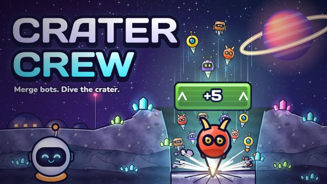 | **Crater Crew** | Merge drill-bots, drop the whole crew into a moon crater and build a night colony from what they dig up. | [Play](https://condrusarsen.github.io/ai-game-lab/games/crater-crew/) |
| 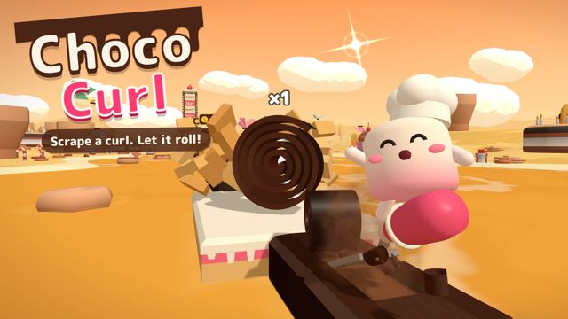 | **Choco Curl** | Hold to scrape a chocolate curl, let it roll through wafer walls, then launch it up the layer cake. | [Play](https://condrusarsen.github.io/ai-game-lab/games/choco-curl/) |
| 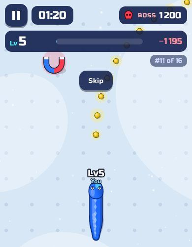 | **Serpent Clash** | Grow a serpent through safe food and risky body bites, then face the boss when the 80-second hunt ends. Twelve bosses. | [Play](https://condrusarsen.github.io/ai-game-lab/games/serpent-clash/) |

### Strategy & roguelite

| | Game | What it is | |
|---|---|---|---|
|  | **Deep Contract** | Mining management and tower defence roguelite: mine by day, defend the platform at night, choose when to evacuate. | [Play](https://condrusarsen.github.io/deep-contract/) · [teardown](teardowns/drill-core.html) |
| 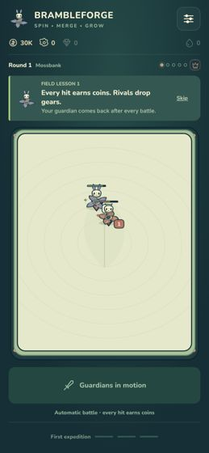 | **Brambleforge** | Merge auto-battler with spinning forest guardians, a 13-step tutorial and a camp meta-game between fights. | [Play](https://condrusarsen.github.io/ai-game-lab/games/brambleforge/) · [teardown](teardowns/brambleforge-reference.html) |

### Stealth, story & physics

| | Game | What it is | |
|---|---|---|---|
| 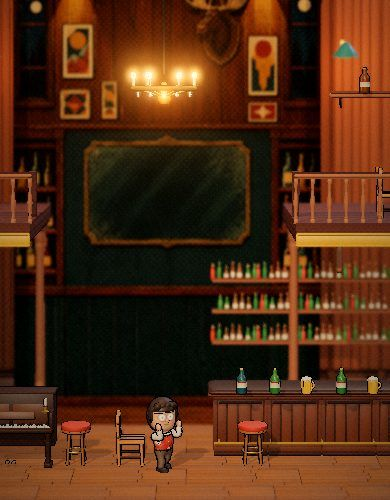 | **I Don't Fight** | Physics brawler where you never punch: slow time, swap the speeds of flying things and let the thugs knock themselves out. | [Play](https://condrusarsen.github.io/ai-game-lab/games/nederus/) |
| 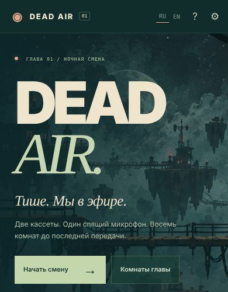 | **Dead Air: Night Shift** | Two-character platformer for desktop: eight rooms, one player with a helper or two players on one keyboard. | [Play](https://condrusarsen.github.io/ai-game-lab/games/dead-air/) |
| 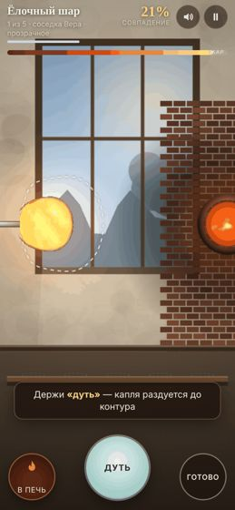 | **Hot Glass** | A glassblower's day: blow, spin and reheat a physically simulated glass bubble to match five orders. | [Play](https://condrusarsen.github.io/ai-game-lab/games/hot-glass/) |
| 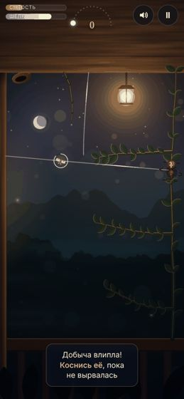 | **Silk Until Dawn** | One night as a garden spider: string silk with Verlet physics, catch moths at the lantern, eat before dawn. | [Play](https://condrusarsen.github.io/ai-game-lab/games/silk-until-dawn/) |
| 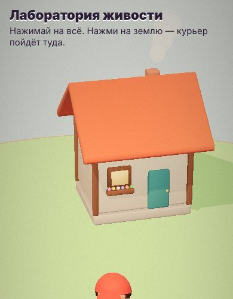 | **Life Lab** | Character-animation sandbox: tap the ground and the felt courier walks there. | [Play](https://condrusarsen.github.io/ai-game-lab/games/lab/) |

## The Vault: 57 more prototypes

**Physics & drawing puzzles**: [Band Bandit](https://condrusarsen.github.io/ai-game-lab/games/band-bandit/) · [Bubblewreck](https://condrusarsen.github.io/ai-game-lab/games/bubblewreck/) · [Clay Fix!](https://condrusarsen.github.io/ai-game-lab/games/clay-fix/) · [Dig & Bloom](https://condrusarsen.github.io/ai-game-lab/games/dig-and-bloom/) · [Glub Glub](https://condrusarsen.github.io/ai-game-lab/games/glub-glub/) · [Houseplant Heist](https://condrusarsen.github.io/ai-game-lab/games/houseplant-heist/) · [Moon Buddies](https://condrusarsen.github.io/ai-game-lab/games/moon-buddies/) · [Moonshot Marshal](https://condrusarsen.github.io/ai-game-lab/games/moonshot-marshal/) · [Snip Snap](https://condrusarsen.github.io/ai-game-lab/games/snip-snap/) · [Spell & Smash](https://condrusarsen.github.io/ai-game-lab/games/spell-and-smash/) · [Wind-Up Agent](https://condrusarsen.github.io/ai-game-lab/games/wind-up-agent/) · [Bone Domino](https://condrusarsen.github.io/ai-game-lab/games/bone-domino/) · [Captain's Bottle](https://condrusarsen.github.io/ai-game-lab/games/captains-bottle/) · [Ink Library](https://condrusarsen.github.io/ai-game-lab/games/ink-library/) · [Lantern Bandit](https://condrusarsen.github.io/ai-game-lab/games/lantern-bandit/) · [Ice Workshop](https://condrusarsen.github.io/ai-game-lab/games/ice-workshop/) · [Weave & Roll](https://condrusarsen.github.io/ai-game-lab/games/weave-and-roll/)

**Arcade & duels**: [Big Top Brawl](https://condrusarsen.github.io/ai-game-lab/games/big-top-brawl/) · [Blot Shot](https://condrusarsen.github.io/ai-game-lab/games/blot-shot/) · [Floe High](https://condrusarsen.github.io/ai-game-lab/games/floe-high/) · [Gulp & Boom](https://condrusarsen.github.io/ai-game-lab/games/gulp-and-boom/) · [Icing Joust](https://condrusarsen.github.io/ai-game-lab/games/icing-joust/) · [Loop & Snip](https://condrusarsen.github.io/ai-game-lab/games/loop-and-snip/) · [MAWSTERS](https://condrusarsen.github.io/ai-game-lab/games/mawsters/) · [Molten Mole](https://condrusarsen.github.io/ai-game-lab/games/molten-mole/) · [Tick & Toll](https://condrusarsen.github.io/ai-game-lab/games/tick-and-toll/) · [Walrus Wallop](https://condrusarsen.github.io/ai-game-lab/games/walrus-wallop/) · [Whittle & Roll](https://condrusarsen.github.io/ai-game-lab/games/whittle-and-roll/) · [Мышиное дело · Mouse Heist](https://condrusarsen.github.io/ai-game-lab/games/mouse-heist/) · [Orbit Slap](https://condrusarsen.github.io/ai-game-lab/games/orbit-slap/) · [Catapult Siege](https://condrusarsen.github.io/ai-game-lab/games/catapult-siege/) · [Manhole Munch](https://condrusarsen.github.io/ai-game-lab/games/manhole-munch/) · [Bone Horde](https://condrusarsen.github.io/ai-game-lab/games/bone-horde/) · [Neon Slice](https://condrusarsen.github.io/ai-game-lab/games/neon-slice/) · [Deepbite](https://condrusarsen.github.io/ai-game-lab/games/deepbite/)

**Stunts & sports**: [Dunk Odyssey](https://condrusarsen.github.io/ai-game-lab/games/dunk-odyssey/) · [Flip & Stick](https://condrusarsen.github.io/ai-game-lab/games/flip-and-stick/) · [Par Avion](https://condrusarsen.github.io/ai-game-lab/games/par-avion/) · [Midnight Garage RC](https://condrusarsen.github.io/ai-game-lab/games/midnight-garage/) · [Tormentone](https://condrusarsen.github.io/ai-game-lab/games/tormentone/)

**Story & choice**: [Hunch Theatre](https://condrusarsen.github.io/ai-game-lab/games/hunch-theatre/) · [Nose for Trouble](https://condrusarsen.github.io/ai-game-lab/games/nose-for-trouble/) · [Plot Twist!](https://condrusarsen.github.io/ai-game-lab/games/plot-twist/) · [Do Not Enter!](https://condrusarsen.github.io/ai-game-lab/games/do-not-enter/) · [One Grown-Up](https://condrusarsen.github.io/ai-game-lab/games/one-grown-up/) · [Panic Key](https://condrusarsen.github.io/ai-game-lab/games/panic-key/) · [Dot Doesn't Nap](https://condrusarsen.github.io/ai-game-lab/games/dot-doesnt-nap/) · [Prop Star](https://condrusarsen.github.io/ai-game-lab/games/prop-star/) · [The Cleaner: Lessons](https://condrusarsen.github.io/ai-game-lab/games/the-cleaner/) · [I Am the Anomaly](https://condrusarsen.github.io/ai-game-lab/games/anomaly/)

**Craft, sim & idle**: [Bust Stop](https://condrusarsen.github.io/ai-game-lab/games/bust-stop/) · [Dr. Pip's Pantry Clinic](https://condrusarsen.github.io/ai-game-lab/games/dr-pips-pantry-clinic/) · [Haggle Hollow](https://condrusarsen.github.io/ai-game-lab/games/haggle-hollow/) · [Midnight Munch](https://condrusarsen.github.io/ai-game-lab/games/midnight-munch/) · [Pocket Quarry](https://condrusarsen.github.io/ai-game-lab/games/pocket-quarry/) · [Foam Patrol](https://condrusarsen.github.io/ai-game-lab/games/foam-patrol/) · [Hexhold: Day & Night](https://condrusarsen.github.io/ai-game-lab/games/hexhold/)


## Workshop

| Project | What it is | Links |
|---|---|---|
| **Arcane Orchard RPG** (Roblox) | Co-op Roblox magic RPG: 7 spells, server-authoritative shop and economy, data-driven enemy AI, Rojo + CI toolchain. AI-assisted refactor under my direction; the NPC system is my hand-written code. | [Code on GitHub](https://github.com/CondrusArsen/arcane-orchard-rpg) |
| **Roblox Feature Pack** (Roblox) | Roblox fundamentals test: pressure plate, GUI clicker with saves, kill parts and checkpoints, tweening. Strict Luau, unit tests, CI. The original 2025 submission is Luau I wrote by hand in Studio (tag original-2025); later refactored with AI. | [Code on GitHub](https://github.com/CondrusArsen/roblox-feature-pack) · [Hand-written original](https://github.com/CondrusArsen/roblox-feature-pack/tree/original-2025) |
| **Match-3 Design Case Study** (Game design) | Three design documents for a casual F2P match-3: the first 200 levels of two hit games compared, a 2×2 ten-layer obstacle with booster rules, and a collection event concept. Analysis and design by me; visuals explored with AI. Documents in Russian. | [Case study on GitHub](https://github.com/CondrusArsen/match3-game-design-case-study) |
| **Blackjack Mobile Game UI** (UI/UX) | Paid client project: full Figma screen flow for a casino-style mobile mini-game, from menu to coin shop. Designed by hand in Figma. | [Screens on GitHub](https://github.com/CondrusArsen/blackjack-mobile-game-ui) |
| **Among Us Story Quiz UI** (UI/UX) | Paid client project: mobile fan-quiz UI with level progression, lives, feedback screens and a shop. Designed by hand in Figma. | [Screens on GitHub](https://github.com/CondrusArsen/among-us-story-mobile-quiz-ui) |
| **School Journal Bot** (Tools) | Telegram bot for class teachers: classes, students, grades by voice or text, reports and Excel export. Python, aiogram, SQLite. Built with AI for my own teaching work. | [Code on GitHub](https://github.com/CondrusArsen/school-journal-bot) |
| **Mini Movie Journal** (Tools) | Personal film and series catalog: search, genre filters, sorting, details pages and a saved light/dark theme. Vanilla JS. Learning project, polished with AI. | [Code on GitHub](https://github.com/CondrusArsen/film-catalog-frontend) |

## How I work with AI

**Gameplay video → teardown → design spec → playable build → playtest and QA.** AI agents draft the analysis and write most of the code; I direct the work and own the decisions.

- **I decide** which reference game to study, what the adaptation keeps, changes and adds (onboarding, economy, pacing, meta), the scope of each iteration and when a build is ready.
- **Agents generate** teardown drafts with evidence frames (each claim tagged observed, inferred or unknown), a design document that maps every rule back to the teardown, the game code and test harnesses.
- **Builds are checked** with rule tests, headless balance bots (e.g. route bots that play all 40 Digit Dash layouts), end-to-end runs in Chrome with touch input at several screen sizes, and my own playtests on phone and desktop.

## Teardowns

**Roblox**: [99 Nights in the Forest](teardowns/roblox/99-nights-in-the-forest.html) · [DOORS](teardowns/roblox/doors.html) · [Dead Rails](teardowns/roblox/dead-rails.html) · [Catch a Brainrot](teardowns/roblox/catch-a-brainrot.html) · [Anime Card Farm](teardowns/roblox/anime-card-farm.html) · [Natural Disaster Survival](teardowns/roblox/natural-disaster-survival.html) · [Creatures of Sonaria](teardowns/roblox/creatures-of-sonaria.html) · [Final Swarm](teardowns/roblox/final-swarm-skills.html) · [Those Who Remain](teardowns/roblox/those-who-remain.html) · [Riot City Prison Escape](teardowns/roblox/riot-city-prison-escape.html) · [Airport Tycoon](teardowns/roblox/airport-tycoon.html) · [Mega Mansion Tycoon](teardowns/roblox/mega-mansion-tycoon.html) · [Garden Cleaner Evolution](teardowns/roblox/garden-cleaner-evolution.html) · [Monkey Escape](teardowns/roblox/speed-monkey-escape.html) · [Backrooms](teardowns/roblox/backrooms.html) · [+1 Speed Keyboard Escape](teardowns/roblox/speed-keyboard-escape.html) · [Survive Zombie Arena](teardowns/roblox/survive-zombie-arena.html)

**Reference games**: [Drill Core](teardowns/drill-core.html) · [Shogun Showdown](teardowns/shogun-showdown.html) · [Gummy Worm Go!](teardowns/sugar-siege-reference.html) · [Brainrot Run: Merge Battle](teardowns/mishmash-run-reference.html) · [Number Master: Run and merge](teardowns/digit-dash-reference.html) · [Blob Merge 3D](teardowns/sticky-blob-descent-reference.html) · [Spinner Merge](teardowns/brambleforge-reference.html)

**Action & shooters**: [Apex Run: Highway Race](teardowns/web/apex-run-highway-race.html) · [Car Soccer](teardowns/web/car-soccer.html) · [Claude of Tanks](teardowns/web/claude-of-tanks.html) · [CORO SOLTO: Treta Suprema](teardowns/web/coro-solto-treta-suprema.html) · [Mecha Royale](teardowns/web/mecha-royale.html) · [Mini Racer](teardowns/web/mini-racer.html) · [Neon Mayhem](teardowns/web/neon-mayhem.html) · [Ringbreaker](teardowns/web/ringbreaker.html) · [Wind & Tanks](teardowns/web/wind-and-tanks.html) · [AFTERHOURS](teardowns/web/afterhours.html)

**Strategy & sim**: [Ashfall Sector](teardowns/web/ashfall-sector.html) · [Divinestead](teardowns/web/divinestead.html) · [Eurasia Hauler: Crossroads Trucking](teardowns/web/eurasia-hauler-crossroads-trucking.html) · [Grid Town](teardowns/web/grid-town.html) · [Ringhold](teardowns/web/ringhold.html) · [Mini Moto](teardowns/web/mini-moto.html) · [For The Fame](teardowns/web/for-the-fame.html) · [Ribat](teardowns/web/ribat.html)

**Puzzle & word**: [Atom By Atom](teardowns/web/atom-by-atom.html) · [Block Burner](teardowns/web/block-burner.html) · [Endless Barkery](teardowns/web/endless-barkery.html) · [Enprise.gg](teardowns/web/enprise-gg.html) · [Expandagram](teardowns/web/expandagram.html) · [Induction](teardowns/web/induction.html) · [Noomo](teardowns/web/noomo.html) · [Save The Toys](teardowns/web/save-the-toys.html) · [The Urinal Game](teardowns/web/the-urinal-game.html) · [Read the Terms](teardowns/web/read-the-terms.html)

**Idle & casual**: [90to90](teardowns/web/90to90.html) · [BREAKAWAY](teardowns/web/breakaway.html) · [What A Wish](teardowns/web/what-a-wish.html) · [PaperRoute](teardowns/web/paperroute.html) · [Falcon Hunt](teardowns/web/falcon-hunt.html) · [Beat the Couch](teardowns/web/beat-the-couch.html) · [Quip](teardowns/web/quip.html) · [H.O.L.E.](teardowns/web/h-o-l-e.html)

**RPG, roguelike & adventure**: [Blister Online](teardowns/web/blister-online.html) · [Cook the Dungeon](teardowns/web/cook-the-dungeon.html) · [Overworld](teardowns/web/overworld.html) · [No Name Squish Game](teardowns/web/no-name-squish-game.html) · [Robot Wants Kitty — HTML5 Remaster](teardowns/web/robot-wants-kitty-html5-remaster.html) · [GRID](teardowns/web/grid.html)

**Experiments & spaces**: [Cenit](teardowns/web/cenit.html) · [Museum of CC0](teardowns/web/museum-of-cc0.html) · [The Endless Museum](teardowns/web/the-endless-museum.html)


## Repository layout

```
index.html        the 3D market (three.js, no build step)
list/             the same content as a plain list
arcade/           market code, data.js (single source for 3D and list), covers, clips
games/<slug>/     playable builds
teardowns/        teardown reports
apps/             small web apps shown in the Workshop
```

Run locally: `python -m http.server` in the repo root, then open http://localhost:8000/.

## Rights

© 2026 Arseni Atrokhov and collaborators. All rights reserved. The games and reports are published for portfolio review only; the code is not open source and may not be copied, modified or redistributed without permission.

Reference games belong to their developers and publishers; they were analysed from public footage and store pages, and no art, audio or text from them is used. Third-party assets (CC0 models and sounds, OFL fonts, MIT libraries such as three.js, music by Kevin MacLeod under CC BY 4.0) are credited in each game's in-game credits.

## Contact

Arseni Atrokhov · [LinkedIn](https://www.linkedin.com/in/arseni-atrokhov/) · [GitHub](https://github.com/CondrusArsen)
