# AI Game Lab

**AI-assisted game developer.** I take a gameplay video of a reference game, turn it into a structured teardown and a design spec, and build a playable mobile web prototype with AI coding agents. I make the design decisions, review the agents' output, and playtest and QA every build.

**Live hub:** https://condrusarsen.github.io/ai-game-lab/

Most games run in a phone browser (portrait, touch) and on desktop (mouse/keyboard); Dead Air is desktop-first. Each one is a static page with no server and no network calls.

## Games

22 playable games and prototypes. Most run in a phone browser (portrait, touch) and on desktop.

### Adaptations of reference games

Each one starts from a teardown of a reference game; a design spec records which rules are kept, changed or designed new. No art, audio or text from the reference games is used.

| | Game | What it is | Reference game analysed | Play |
|---|---|---|---|---|
|  | **Deep Contract** | Mining management and tower defence roguelite: mine by day, defend the platform at night, choose when to evacuate. Own repo: [deep-contract](https://github.com/CondrusArsen/deep-contract) | *Drill Core* (PC) · [teardown](teardowns/drill-core.html) | [Play](https://condrusarsen.github.io/deep-contract/) |
|  | **Sugar Siege** | 3D runner: grow a jelly worm, carry TNT to a candy castle gate, then fund and rebuild a city behind it. | *Gummy Worm Go!* · [teardown](teardowns/sugar-siege-reference.html) | [Play](https://condrusarsen.github.io/ai-game-lab/games/sugar-siege/) |
|  | **Mishmash Run** | Crowd runner into a merge auto-battler: steer hybrid creatures through gates, fuse twins on a 5×3 board, fight. Bosses, challenge mode, collection index. | *Brainrot Run: Merge Battle* · [teardown](teardowns/mishmash-run-reference.html) | [Play](https://condrusarsen.github.io/ai-game-lab/games/mishmash-run/) |
|  | **Digit Dash** | 3D number runner: swallow smaller numbers, avoid bigger ones, ram the wall staircase for cash, buy upgrades. 40 authored layouts plus endless remixes. | *Number Master: Run and merge* · [teardown](teardowns/digit-dash-reference.html) | [Play](https://condrusarsen.github.io/ai-game-lab/games/digit-dash/) |
|  | **Brambleforge** | Merge auto-battler with spinning forest guardians, a 13-step tutorial and a camp meta-game between fights. | *Spinner Merge* · [teardown](teardowns/brambleforge-reference.html) | [Play](https://condrusarsen.github.io/ai-game-lab/games/brambleforge/) |
| 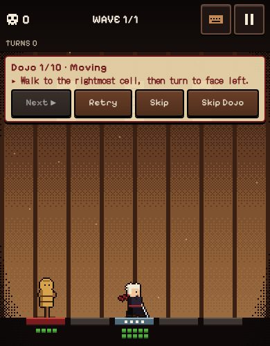 | **Shogun Lane** | Single-lane, turn-based samurai roguelite for phones: queue attack tiles, read enemy intent, move bodies so committed strikes land on empty cells. Built from the teardown alone. | *Shogun Showdown* (PC) · [teardown](teardowns/shogun-showdown.html) | [Play](https://condrusarsen.github.io/ai-game-lab/games/shogun-lane/) |

### Original games

New concepts: research, a set of concepts, one picked and built. Art is generated or drawn in code; no third-party asset packs.

| | Game | What it is | Play |
|---|---|---|---|
| 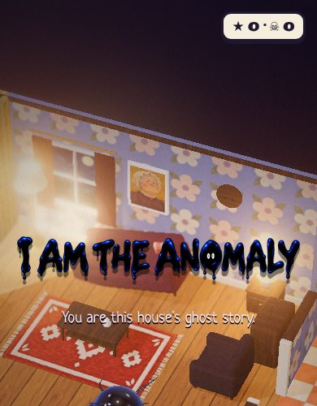 | **I Am the Anomaly** | Stealth prank in 3D: you are a living ink blot haunting a dollhouse. Prank the plush night inspectors, hide in the dark, scare them out. RU / EN. | [Play](https://condrusarsen.github.io/ai-game-lab/games/anomaly/) |
| 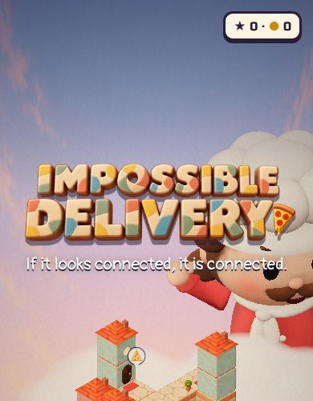 | **Impossible Delivery** | Optical-illusion puzzle: turn an impossible tower until the walkways line up; if it looks connected, it is connected. RU / EN. | [Play](https://condrusarsen.github.io/ai-game-lab/games/impossible/) |
| 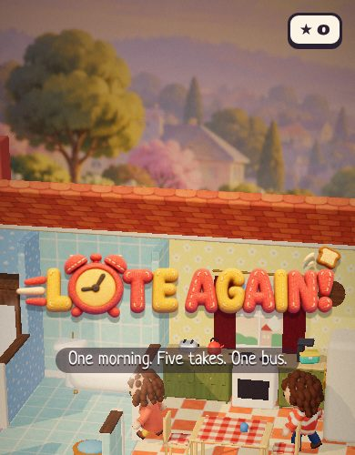 | **Late Again!** | Time-loop puzzle: play one family morning as each member in turn while your earlier takes repeat beside you as echoes. RU / EN. | [Play](https://condrusarsen.github.io/ai-game-lab/games/late/) |
| 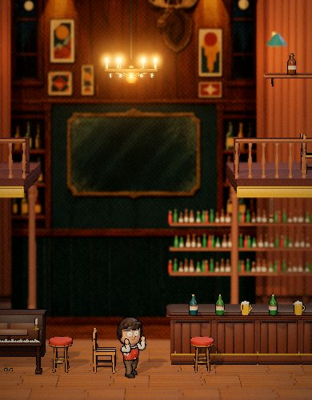 | **I Don't Fight** | Physics brawler where you never punch: slow time, swap the speeds of flying things and let the thugs knock themselves out. RU / EN. | [Play](https://condrusarsen.github.io/ai-game-lab/games/nederus/) |
| 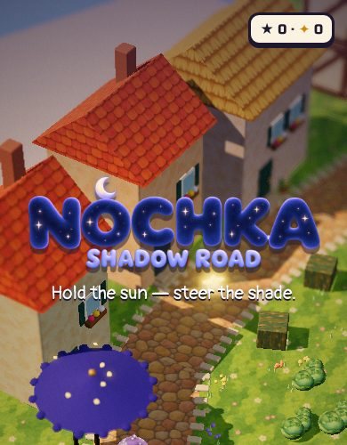 | **Nochka: Shadow Road** | Light-and-shadow puzzle: drag the sun across the sky so the shadows swing under a scrap of night walking home. RU / EN. | [Play](https://condrusarsen.github.io/ai-game-lab/games/nochka/) |
| 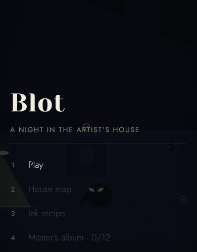 | **Blot** | 2D stealth scare puzzle: chain different scares on the night inspectors and stay out of their flashlight beams. | [Play](https://condrusarsen.github.io/ai-game-lab/games/blot/) |
|  | **Pizza in Perspective** | Hand-drawn perspective puzzle: line two roofs up on screen, then walk the pizza across a bridge that exists only from your viewpoint. | [Play](https://condrusarsen.github.io/ai-game-lab/games/pizza-in-perspective/) |
|  | **Dead Air: Night Shift** | Two-character platformer for desktop: eight rooms, one player with a helper or two players on one keyboard. RU / EN. | [Play](https://condrusarsen.github.io/ai-game-lab/games/dead-air/) |
|  | **Hot Glass** | A glassblower's day: blow, spin and reheat a physically simulated glass bubble to match five orders. WebGL2, all art and sound generated in code. UI in Russian. | [Play](https://condrusarsen.github.io/ai-game-lab/games/hot-glass/) |
|  | **Silk Until Dawn** | One night as a garden spider: string silk with Verlet physics, catch moths at the lantern, eat before dawn. Procedural art, synthesized audio. UI in Russian. | [Play](https://condrusarsen.github.io/ai-game-lab/games/silk-until-dawn/) |

### Arcade and puzzle

Short-session games built for a mobile web games platform. Neon Slice and Deepbite reuse the cores of Flip & Slice and Serpent Clash with a new theme and new content.

| | Game | What it is | Play |
|---|---|---|---|
| 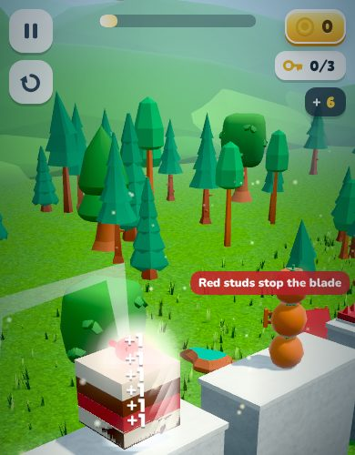 | **Flip & Slice** | One-thumb knife toy: every tap flips the blade. Slice cakes, fruit and toys, stop before the red studs. 36 courses, then endless remixes. | [Play](https://condrusarsen.github.io/ai-game-lab/games/flip-and-slice/) |
| 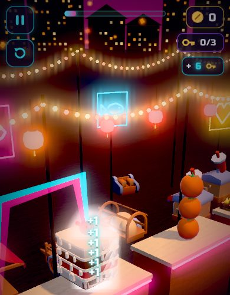 | **Neon Slice** | Flip & Slice rebuilt as a neon night market with new districts and content. | [Play](https://condrusarsen.github.io/ai-game-lab/games/neon-slice/) |
| 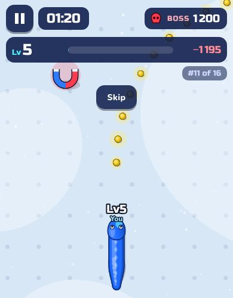 | **Serpent Clash** | Grow a serpent through safe food and risky body bites, then face the boss when the 80-second hunt ends. Twelve bosses. | [Play](https://condrusarsen.github.io/ai-game-lab/games/serpent-clash/) |
| 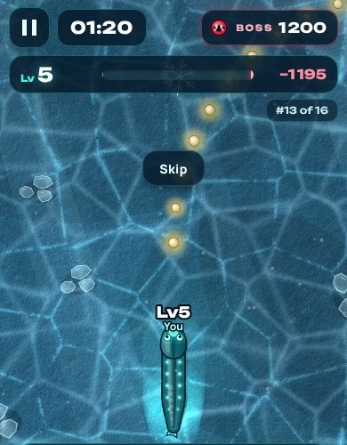 | **Deepbite** | Serpent Clash moved to the deep sea: twelve depths, each with its own leviathan. | [Play](https://condrusarsen.github.io/ai-game-lab/games/deepbite/) |
| 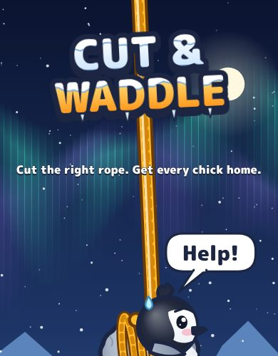 | **Cut & Waddle** | Rope-cutting physics puzzle: get every penguin chick out of the frozen harbour. 60 classic rooms, 30 rescue-everyone rooms, a VS race. | [Play](https://condrusarsen.github.io/ai-game-lab/games/cut-and-waddle/) |
|  | **Life Lab** | Tech experiment: character-animation sandbox; tap the ground and the felt courier walks there. | [Play](https://condrusarsen.github.io/ai-game-lab/games/lab/) |

## How I work with AI

The pipeline is **gameplay video → teardown report → design spec → prototype → playtest and QA**. AI agents (Codex, Claude) draft the analysis and write most of the code. I direct the work and own the decisions.

**What I decide**
- Which reference game to study and which recordings to use.
- What the adaptation is: theme and art direction, which rules stay, which change, and what is designed new (onboarding, economy, pacing, meta-game).
- Scope and priorities for each iteration; what gets cut.
- Whether a build feels right and is ready to show.

**What the agents generate**
- First drafts of the teardown: rules and numbers with evidence frames, each claim tagged as observed, inferred or unknown.
- A `DESIGN.md` per game that maps every rule of the adaptation back to the teardown (kept, adapted or newly designed).
- Game code (TypeScript/JavaScript; Canvas 2D, WebGL, three.js), a build that inlines everything into one HTML file, and the test harnesses.
- Asset sourcing with saved licence evidence and a generated Credits screen.

**How the builds are checked** (from each project's README and verification notes)
- **Rule tests** (vitest) on the simulation: acceptance cases written from the spec, save/restore, economy.
- **Bots:** headless balance bots and economy simulations, e.g. route bots that play all 40 Digit Dash layouts, a greedy-merge bot for Mishmash Run, 120 progression runs to battle 51 for Brambleforge, a glass-physics bot checking every Hot Glass order is reachable at three stars.
- **End-to-end on the release file** in Chrome with real touch input, plus 20-minute session runs and layout checks at several screen sizes (e.g. 390×844, 360×640, landscape).
- **Licence check scripts** compare every shipped asset with its saved licence evidence.
- **My own playtests** on phone and desktop, with bug lists and fixes per iteration.

The projects' verification notes also list what is *not* verified yet: real iOS Safari over HTTPS and sessions with outside players. No retention or engagement numbers are claimed.

## Teardowns

54 long-form HTML reports with embedded evidence frames: core loop, rules, economy, first session, UI and what to borrow.

**Reference games behind the adaptations**

- [Drill Core](teardowns/drill-core.html): mining management and tower defence roguelite (Hungry Couch Games / tinyBuild). Basis for Deep Contract.
- [Shogun Showdown](teardowns/shogun-showdown.html): single-lane, turn-based tactical roguelite (Roboatino). Basis for Shogun Lane.
- [Gummy Worm Go!](teardowns/sugar-siege-reference.html): 3D jelly-worm runner with a city-building meta. Basis for Sugar Siege.
- [Brainrot Run: Merge Battle](teardowns/mishmash-run-reference.html): crowd runner feeding a merge auto-battle. Basis for Mishmash Run.
- [Number Master: Run and merge](teardowns/digit-dash-reference.html): number runner with a wall-staircase payout. Basis for Digit Dash.
- [Blob Merge 3D](teardowns/sticky-blob-descent-reference.html): physics merge drop puzzle.
- [Spinner Merge](teardowns/brambleforge-reference.html): spinning-top merge auto-battler. Basis for Brambleforge.

**Roblox**

- [+1 Speed Keyboard Escape](teardowns/roblox/speed-keyboard-escape.html) (SecretVerse Studio): incremental obby where every step adds +1 speed.
- [Survive Zombie Arena](teardowns/roblox/survive-zombie-arena.html) (Nectarforge Studios): co-op wave survival for up to 25 players.

**Browser games (45)**

[90to90](teardowns/web/90to90.html) · [AFTERHOURS](teardowns/web/afterhours.html) · [Apex Run: Highway Race](teardowns/web/apex-run-highway-race.html) · [Ashfall Sector](teardowns/web/ashfall-sector.html) · [Atom By Atom](teardowns/web/atom-by-atom.html) · [Beat the Couch](teardowns/web/beat-the-couch.html) · [Blister Online](teardowns/web/blister-online.html) · [Block Burner](teardowns/web/block-burner.html) · [BREAKAWAY](teardowns/web/breakaway.html) · [Car Soccer](teardowns/web/car-soccer.html) · [Cenit](teardowns/web/cenit.html) · [Claude of Tanks](teardowns/web/claude-of-tanks.html) · [Cook the Dungeon](teardowns/web/cook-the-dungeon.html) · [CORO SOLTO: Treta Suprema](teardowns/web/coro-solto-treta-suprema.html) · [Divinestead](teardowns/web/divinestead.html) · [Endless Barkery](teardowns/web/endless-barkery.html) · [Enprise.gg](teardowns/web/enprise-gg.html) · [Eurasia Hauler: Crossroads Trucking](teardowns/web/eurasia-hauler-crossroads-trucking.html) · [Expandagram](teardowns/web/expandagram.html) · [Falcon Hunt](teardowns/web/falcon-hunt.html) · [For The Fame](teardowns/web/for-the-fame.html) · [GRID](teardowns/web/grid.html) · [Grid Town](teardowns/web/grid-town.html) · [H.O.L.E.](teardowns/web/h-o-l-e.html) · [Induction](teardowns/web/induction.html) · [Mecha Royale](teardowns/web/mecha-royale.html) · [Mini Moto](teardowns/web/mini-moto.html) · [Mini Racer](teardowns/web/mini-racer.html) · [Museum of CC0](teardowns/web/museum-of-cc0.html) · [Neon Mayhem](teardowns/web/neon-mayhem.html) · [No Name Squish Game](teardowns/web/no-name-squish-game.html) · [Noomo](teardowns/web/noomo.html) · [Overworld](teardowns/web/overworld.html) · [PaperRoute](teardowns/web/paperroute.html) · [Quip](teardowns/web/quip.html) · [Read the Terms](teardowns/web/read-the-terms.html) · [Ribat](teardowns/web/ribat.html) · [Ringbreaker](teardowns/web/ringbreaker.html) · [Ringhold](teardowns/web/ringhold.html) · [Robot Wants Kitty — HTML5 Remaster](teardowns/web/robot-wants-kitty-html5-remaster.html) · [Save The Toys](teardowns/web/save-the-toys.html) · [The Endless Museum](teardowns/web/the-endless-museum.html) · [The Urinal Game](teardowns/web/the-urinal-game.html) · [What A Wish](teardowns/web/what-a-wish.html) · [Wind & Tanks](teardowns/web/wind-and-tanks.html)

## Repository layout

```
index.html            hub page (GitHub Pages)
games/<slug>/         playable builds (single-file HTML; Hot Glass and Silk Until Dawn are ES modules, Shogun Lane is a static build)
teardowns/            teardown reports (web/ and roblox/ subfolders)
media/                screenshots
```

To run locally: `python -m http.server` in the repo root, then open http://localhost:8000/. Hot Glass and Silk Until Dawn use ES modules and need a server; the other games also open from disk.

## Credits and licences

- **Reference games** belong to their developers and publishers. They were analysed from public footage and store pages; no art, audio, text or footage from them is used in these games.
- **Third-party assets** are credited per file in each game's in-game *Credits & licences* screen, including licence text where required:
  - sound effects and 3D models under **CC0** (Kenney, OpenGameArt, Freesound, Poly Pizza / Quaternius, ambientCG textures);
  - music by Kevin MacLeod (incompetech.com) under **CC BY 4.0** (Sugar Siege);
  - fonts under the **SIL Open Font License 1.1** (Nunito, Fredoka, Bangers, Lilita One);
  - three.js under the **MIT License**.
- Hot Glass and Silk Until Dawn use no third-party assets or libraries: all graphics and sound are generated in code.
- I Am the Anomaly, Impossible Delivery, Late Again!, I Don't Fight, Nochka and Life Lab use no third-party models or asset packs: images are generated for the project, sound and music are synthesized in code; libraries are three.js and planck.js (MIT).
- Shogun Lane uses CC0 sound effects (Kenney, OpenGameArt) and two SIL OFL fonts (DotGothic16, Pixelify Sans); the full list is in its in-game Credits.
- The games were built July–October 2026 while I worked at Bloom Labs. Some builds include optional hooks for the bug.games platform SDK; they only activate when the game runs inside the platform's frame and do nothing on this site.

## Contact

Arseni Atrokhov · [LinkedIn](https://www.linkedin.com/in/arseni-atrokhov/) · [GitHub](https://github.com/CondrusArsen)
