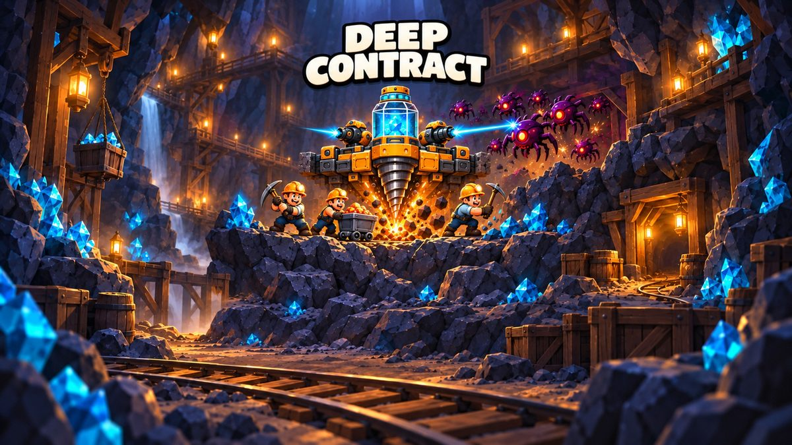
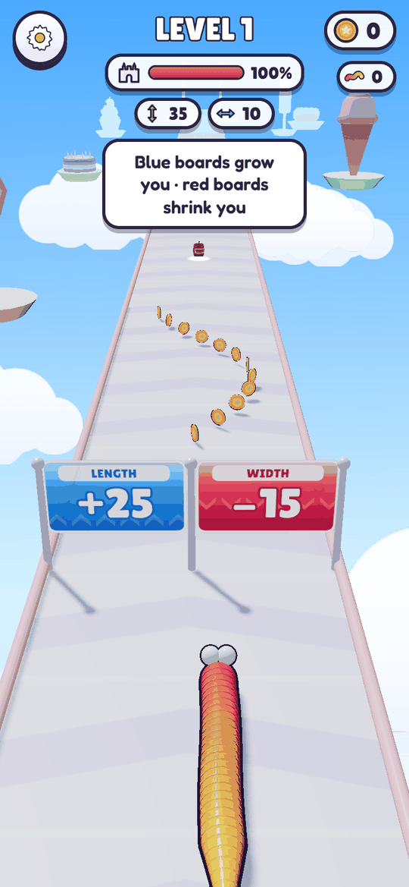
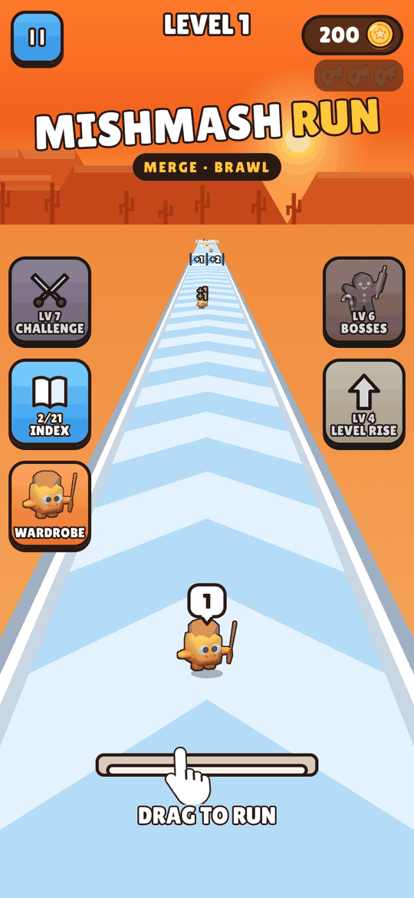
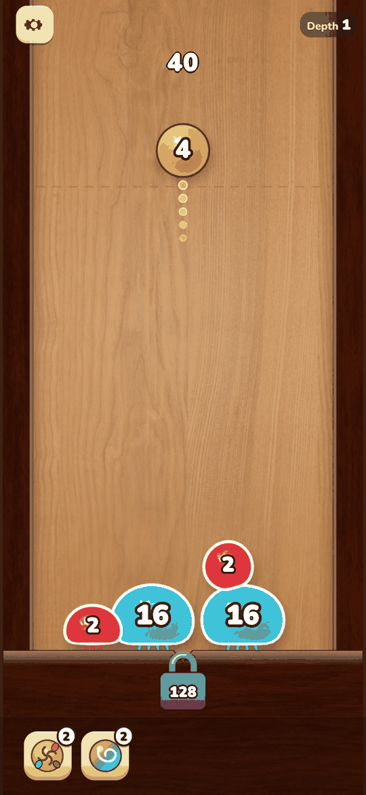
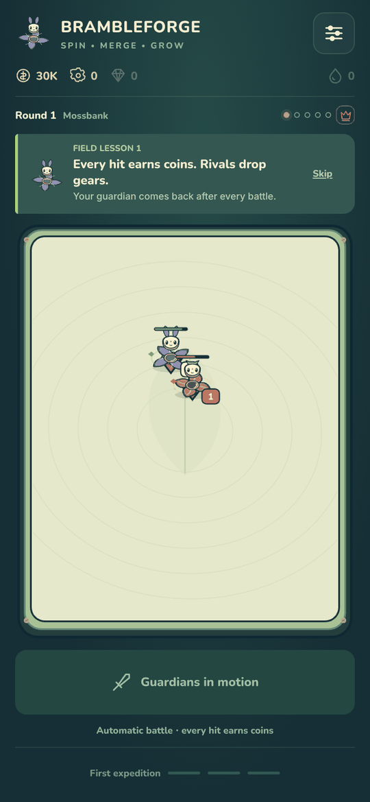
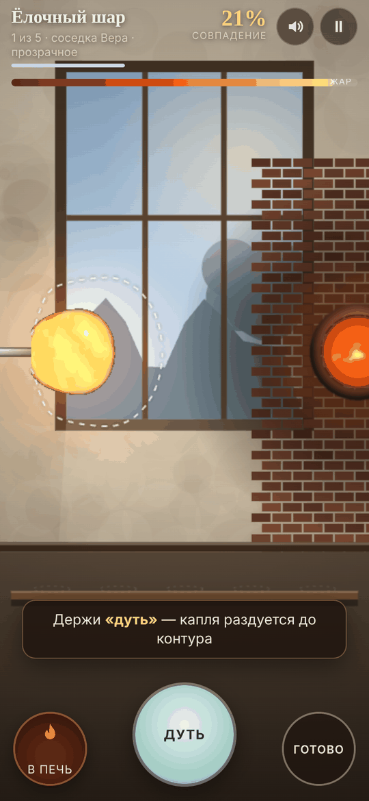
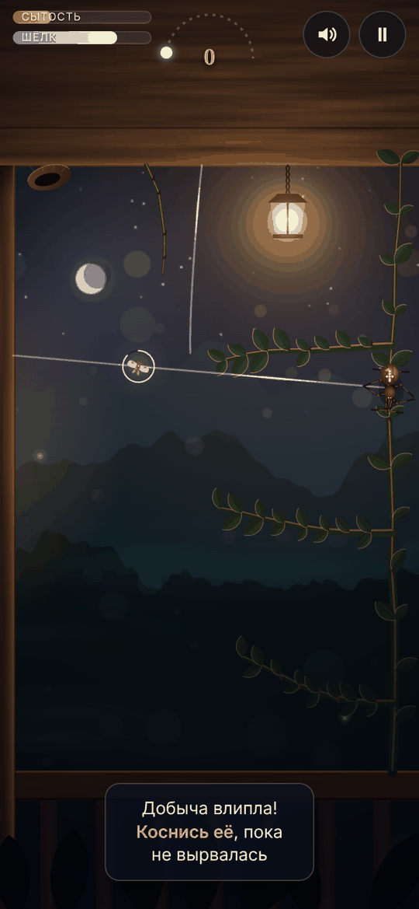

# AI Game Lab

**AI-assisted game developer.** I take a gameplay video of a reference game, turn it into a structured teardown and a design spec, and build a playable mobile web prototype with AI coding agents. I make the design decisions, review the agents' output, and playtest and QA every build.

**Live hub:** https://condrusarsen.github.io/ai-game-lab/

All games run in a phone browser (portrait, touch) and on desktop (mouse/keyboard). Each one is a static page with no server and no network calls.

## Games

| | Game | What it is | Reference game analysed | Play |
|---|---|---|---|---|
|  | **Deep Contract** | Mining management and tower defence roguelite: mine by day, defend the platform at night, choose when to evacuate. Own repo: [deep-contract](https://github.com/CondrusArsen/deep-contract) | *Drill Core* (PC) · [teardown](teardowns/drill-core.html) | [Play](https://condrusarsen.github.io/deep-contract/) |
|  | **Sugar Siege** | 3D runner: grow a jelly worm, carry TNT to a candy castle gate, then fund and rebuild a city behind it. | *Gummy Worm Go!* · [teardown](teardowns/sugar-siege-reference.html) | [Play](https://condrusarsen.github.io/ai-game-lab/games/sugar-siege/) |
|  | **Mishmash Run** | Crowd runner into a merge auto-battler: steer hybrid creatures through gates, fuse twins on a 5×3 board, fight. Bosses, challenge mode, collection index. | *Brainrot Run: Merge Battle* · [teardown](teardowns/mishmash-run-reference.html) | [Play](https://condrusarsen.github.io/ai-game-lab/games/mishmash-run/) |
|  | **Digit Dash** | 3D number runner: swallow smaller numbers, avoid bigger ones, ram the wall staircase for cash, buy upgrades. 40 authored layouts plus endless remixes. | *Number Master: Run and merge* · [teardown](teardowns/digit-dash-reference.html) | [Play](https://condrusarsen.github.io/ai-game-lab/games/digit-dash/) |
|  | **Sticky Blob Descent** | Physics merge puzzle: launch numbered jelly blobs that stick where they land, fuse equals, open floor locks and descend. | *Blob Merge 3D* · [teardown](teardowns/sticky-blob-descent-reference.html) | [Play](https://condrusarsen.github.io/ai-game-lab/games/sticky-blob-descent/) |
|  | **Brambleforge** | Merge auto-battler with spinning forest guardians, a 13-step tutorial and a camp meta-game between fights. | *Spinner Merge* · [teardown](teardowns/brambleforge-reference.html) | [Play](https://condrusarsen.github.io/ai-game-lab/games/brambleforge/) |
|  | **Hot Glass** | Original concept. A glassblower's day: blow, spin and reheat a physically simulated glass bubble to match five orders. WebGL2, all art and sound generated in code. UI in Russian. | Original (research → 10 concepts → one picked) | [Play](https://condrusarsen.github.io/ai-game-lab/games/hot-glass/) |
|  | **Silk Until Dawn** | Original concept. One night as a garden spider: string silk with Verlet physics, catch moths at the lantern, eat before dawn. Procedural art, synthesized audio. UI in Russian. | Original (research → 10 concepts → one picked) | [Play](https://condrusarsen.github.io/ai-game-lab/games/silk-until-dawn/) |

## How I work with AI

The pipeline is **gameplay video → teardown report → design spec → prototype → playtest and QA**. AI agents (Codex, Claude) draft the analysis and write most of the code. I direct the work and own the decisions.

**What I decide**
- Which reference game to study and which recordings to use.
- What the adaptation is: theme and art direction, which rules stay, which change, and what is designed new (onboarding, economy, pacing, meta-game).
- Scope and priorities for each iteration; what gets cut.
- Whether a build feels right and is ready to show.

**What the agents generate**
- First drafts of the teardown: rules and numbers with evidence frames, each claim tagged as observed, inferred or unknown.
- A `DESIGN.md` per game that maps every rule of the adaptation back to the teardown (kept, adapted or newly designed).
- Game code (TypeScript/JavaScript; Canvas 2D, WebGL, three.js), a build that inlines everything into one HTML file, and the test harnesses.
- Asset sourcing with saved licence evidence and a generated Credits screen.

**How the builds are checked** (from each project's README and verification notes)
- **Rule tests** (vitest) on the simulation: acceptance cases written from the spec, save/restore, economy.
- **Bots:** headless balance bots and economy simulations, e.g. route bots that play all 40 Digit Dash layouts, a greedy-merge bot for Mishmash Run, 120 progression runs to battle 51 for Brambleforge, a glass-physics bot checking every Hot Glass order is reachable at three stars.
- **End-to-end on the release file** in Chrome with real touch input, plus 20-minute session runs and layout checks at several screen sizes (e.g. 390×844, 360×640, landscape).
- **Licence check scripts** compare every shipped asset with its saved licence evidence.
- **My own playtests** on phone and desktop, with bug lists and fixes per iteration.

The projects' verification notes also list what is *not* verified yet: real iOS Safari over HTTPS and sessions with outside players. No retention or engagement numbers are claimed.

## Teardowns

Long-form HTML reports with embedded evidence frames (3–18 MB each):

- [Drill Core](teardowns/drill-core.html): mining management and tower defence roguelite (Hungry Couch Games / tinyBuild). Basis for Deep Contract.
- [Shogun Showdown](teardowns/shogun-showdown.html): single-lane, turn-based tactical roguelite (Roboatino). Basis for a mobile design adaptation that is specified but not yet built.
- [Gummy Worm Go!](teardowns/sugar-siege-reference.html): 3D jelly-worm runner with a city-building meta. Basis for Sugar Siege.
- [Brainrot Run: Merge Battle](teardowns/mishmash-run-reference.html): Crowd runner feeding a merge auto-battle. Basis for Mishmash Run.
- [Number Master: Run and merge](teardowns/digit-dash-reference.html): Number runner with a wall-staircase payout. Basis for Digit Dash.
- [Blob Merge 3D](teardowns/sticky-blob-descent-reference.html): Physics merge drop puzzle. Basis for Sticky Blob Descent.
- [Spinner Merge](teardowns/brambleforge-reference.html): Spinning-top merge auto-battler. Basis for Brambleforge.

## Repository layout

```
index.html            hub page (GitHub Pages)
games/<slug>/         playable builds (single-file HTML, or ES-module source for Hot Glass / Silk Until Dawn)
teardowns/            teardown reports
media/                screenshots
```

To run locally: `python -m http.server` in the repo root, then open http://localhost:8000/. Hot Glass and Silk Until Dawn use ES modules and need a server; the other games also open from disk.

## Credits and licences

- **Reference games** belong to their developers and publishers. They were analysed from public footage and store pages; no art, audio, text or footage from them is used in these games.
- **Third-party assets** are credited per file in each game's in-game *Credits & licences* screen, including licence text where required:
  - sound effects and 3D models under **CC0** (Kenney, OpenGameArt, Freesound, Poly Pizza / Quaternius, ambientCG textures);
  - music by Kevin MacLeod (incompetech.com) under **CC BY 4.0** (Sugar Siege, Sticky Blob Descent);
  - fonts under the **SIL Open Font License 1.1** (Nunito, Fredoka, Bangers, Lilita One);
  - three.js under the **MIT License**.
- Hot Glass and Silk Until Dawn use no third-party assets or libraries: all graphics and sound are generated in code.
- The games were built July–October 2026 while I worked at Bloom Labs. Some builds include optional hooks for the bug.games platform SDK; they only activate when the game runs inside the platform's frame and do nothing on this site.

## Contact

Arseni Atrokhov · [LinkedIn](https://www.linkedin.com/in/arseni-atrokhov/) · [GitHub](https://github.com/CondrusArsen)
